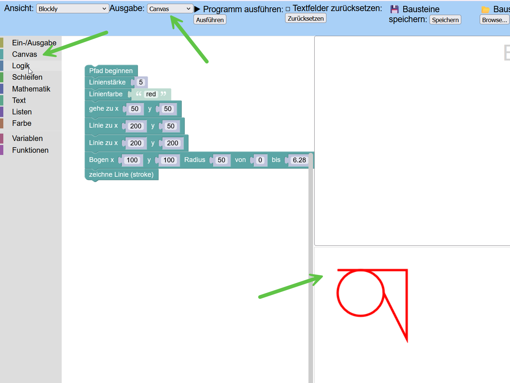

# bwinf-blockly-editor

Enriched the Blockly editor from https://bwinf.de/mehr-informatik/lernen/programmieren-lernen/blockly/ w/ a canvas and some basic draw functions.

Usable online at https://cristian-spiescu.github.io/bwinf-blockly-editor/eingabe_ausgabe2/.

Unfortunately the Git repo that seems to have been associated to this project is not accessible. I first modified the offline version named "1.2", that was offered as `.zip` download. Result is in: `eingabe_ausgabe`. This seems to be an older version compared to the online one. Issues w/ the older version:

* UI a bit more unpolished;
* big issue on Edge. Cannot drag Blockly blocks;
* missing "Browse for input file"

Next I downloaded the offline version, and applied basically the same modifs. Result in `eingabe_ausgabe2`.